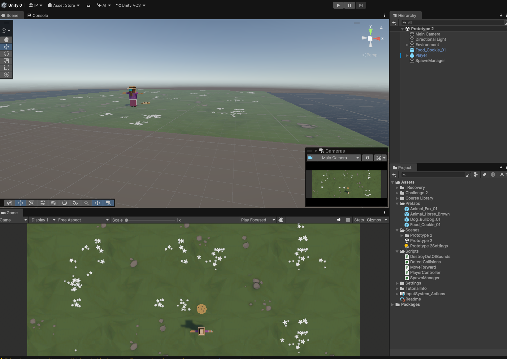
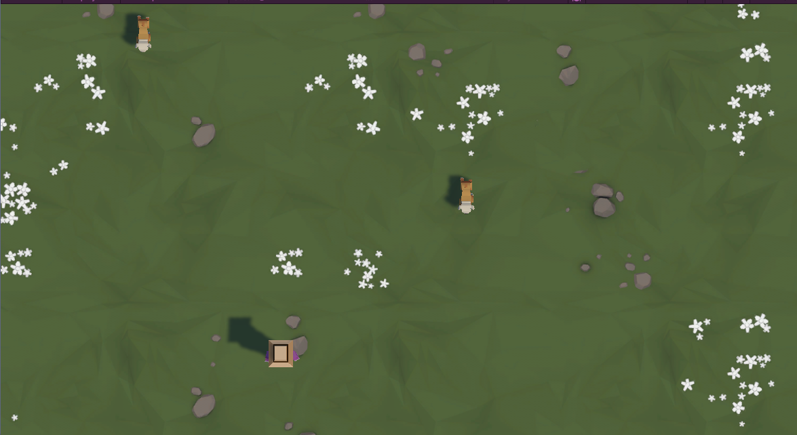
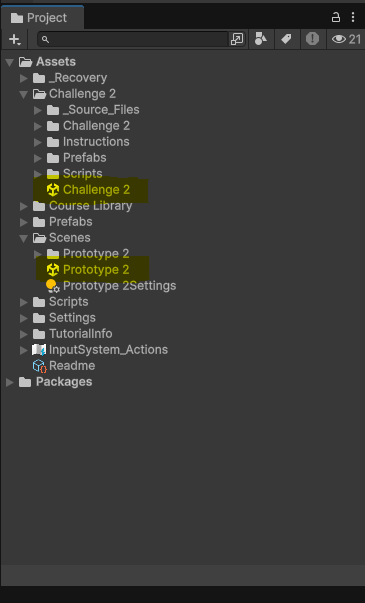

# Eläinpelit (C# & Unity)

 Kaksi C#-kielellä toteutettua minipeliä samassa Unity-projektissa:
- **Eläinpeli** – syötä eläimiä kekseillä
- **Koirapeli** – lähetä koira noutamaan putoavia palloja

## Teknologiat
- C# 
- Unity 6.5

## Ominaisuudet
- Kaksi erillistä eläinpeliä samassa projektissa
- Yksinkertainen objektien väistely ja kiinniottaminen
- Nuolinäppäinohjaus Eläinpelissä
- Välilyönti ampuu molemmissa peleissä

## Ohjaus
| Näppäin | Toiminto          |
|---------|-------------------|
| Space   | Ampuu             |   
| ←       | Vasemmalle        |
| →       | Oikealle          |

## Esivaatimukset
- Visual Studio (suositeltava koodieditori)
- Unity versio 6.5 (tai yhteensopiva versio)
- Unity Hub

## Käyttöönotto ja testaus
1. Kloonaa repositorio koneellesi:
```bash
git clone https://github.com/iidapartanen-dev/El-inpelit.git
```
2. Avaa Unity Hub → Add → valitse kloonattu projektikansio (Eläinpeli).
3. Avaa projekti Unity Editorissa.
4. Valitse haluamasi peli Scenes-kansiosta (tai File → Open Scene) ja paina Play.
Huom. Koirapelissä vain ammutaan koiria matkaan

Pelin vaihtaminen tapahtuu vaihtamalla Sceneä (katso kuvakaappaus alla).

## Kuvakaappaukset

### Aloitusnäkymä

<image-card alt="Aloitusnäkymä" src="screenshots/aloitus.png" ></image-card>

### Eläinpeli

<image-card alt="Eläinpeli" src="screenshots/eläinpeli.png" ></image-card>

### Koirapeli

<image-card alt="Koirapeli" src="screenshots/auto_näkymä.png" ></image-card>

### Pelin vaihto

<image-card alt="Pelin vaihto" src="screenshots/vaihto.png" ></image-card>